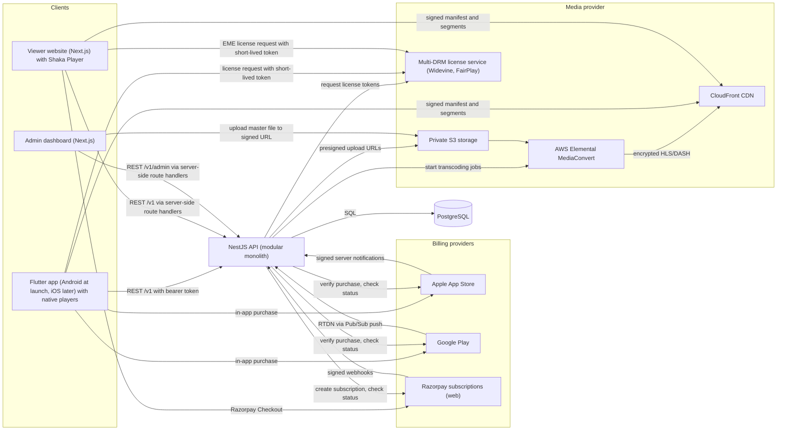
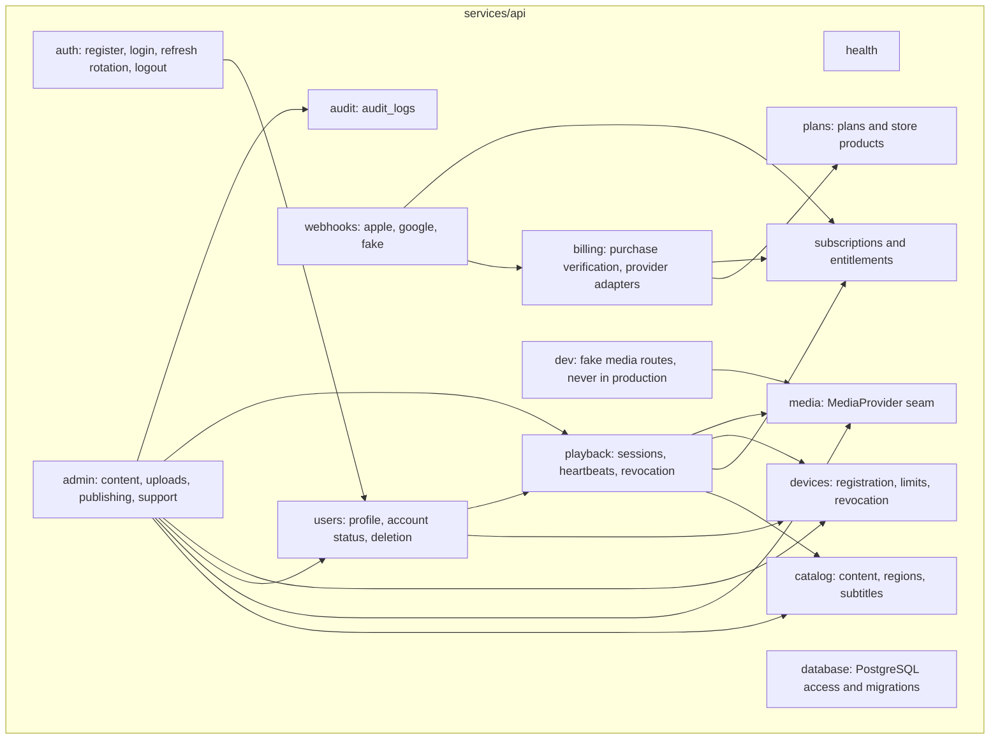
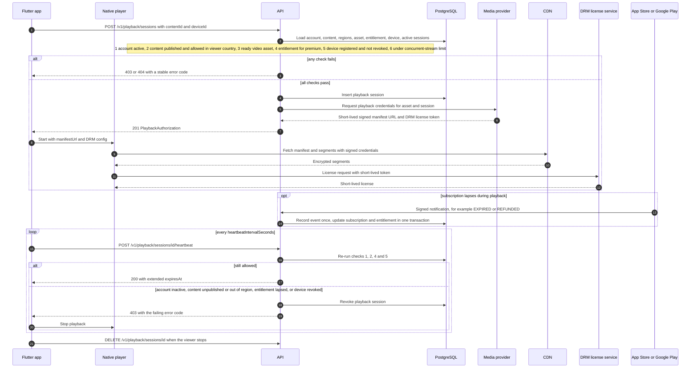
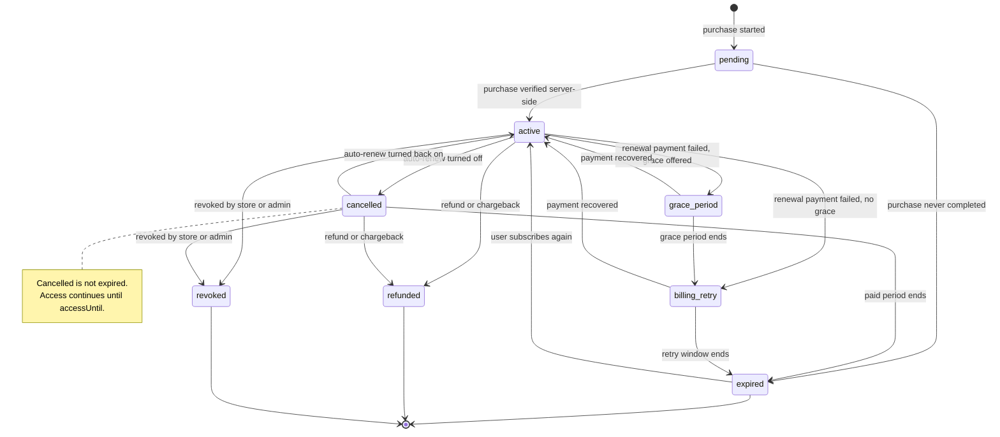
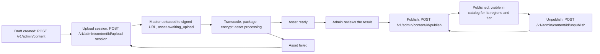
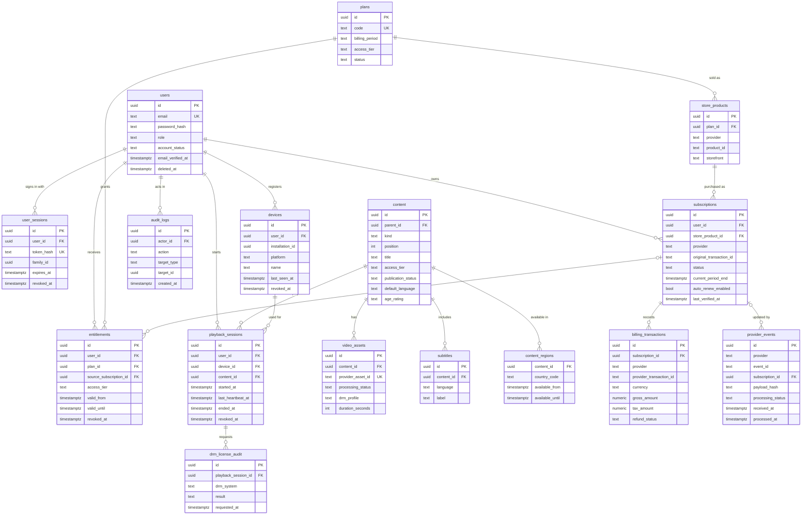

# Architecture overview

This document shows how StreamingApp fits together. It complements:

- [`api-contract.md`](api-contract.md): the authoritative v1 API contract (endpoints, types, error
  codes, environment variables). Where this overview and the contract differ, the contract wins.
- [`../PROJECT_PLAN.md`](../PROJECT_PLAN.md): the product and technical plan.
- [`../security/threat-model.md`](../security/threat-model.md): the threat model.

Diagrams use Mermaid and render on GitHub.

## Design principles

1. **The server decides access.** The mobile app never decides whether someone may watch premium
   content. It shows what the API returns (`SubscriptionView.hasAccess`) and stops playback on any
   `403`.
2. **Payments and access are separate.** Billing providers tell us what was paid. The backend turns
   verified provider state into one normalized subscription and entitlement per user.
3. **Video never flows through the API.** The API issues short-lived credentials; the player fetches
   media from the CDN and licenses from the DRM service directly.
4. **External providers sit behind seams.** Media and billing are interfaces with fake
   implementations for development and fail-closed real implementations until configured.
5. **Modular monolith.** One NestJS deployable with clear module boundaries, split later only if
   needed.

## System context

Notes:

- The admin dashboard and the viewer website both keep tokens in httpOnly cookies set by their own
  Next.js route handlers and call the API from the server side; the browser never sees the API tokens.
  Only media, DRM license and Razorpay Checkout traffic goes directly from the browser.
- A subscription bought through Google Play or Razorpay produces the same per-account entitlement, so
  it unlocks both the app and the website.
- Signed CloudFront URLs or cookies are generated by the API with a private key held in the secret
  manager; the matching public key is registered with CloudFront. The private key never leaves the
  server side.
- The viewer's country comes from a trusted CDN header (`TRUSTED_COUNTRY_HEADER`, for example
  `cloudfront-viewer-country`) or the configured default, never from the client.
- In development the whole media provider box is replaced by the fake media provider, and the billing
  providers by the fake billing provider (see [Provider seams](#provider-seams)).

## API module map

Every module persists through the database module; those edges are left out for readability. Deleting
an account (`DELETE /v1/me`) revokes the user's login sessions, devices and playback sessions, which is
why `users` depends on `devices` and `playback`.

| Module | Owns tables | Main endpoints |
|---|---|---|
| auth | `user_sessions` | `/v1/auth/*` |
| users | `users` | `/v1/me` |
| catalog | `content`, `video_assets`, `subtitles`, `content_regions` | `/v1/catalog`, `/v1/content/:id` |
| plans | `plans`, `store_products` | `/v1/plans` |
| billing, subscriptions and entitlements | `subscriptions`, `billing_transactions`, `entitlements` | `/v1/me/subscription`, `/v1/purchases/verify` |
| webhooks | `provider_events` | `/v1/webhooks/*` |
| devices | `devices` | `/v1/me/devices` |
| playback | `playback_sessions`, `drm_license_audit` | `/v1/playback/sessions*` |
| admin and audit | `audit_logs` | `/v1/admin/*` |

## Playback authorization sequence

The checks run in the order defined in the
[contract](api-contract.md#playback); the first failure wins.

Points worth noting:

- **Four separate expiries:** access token (`ACCESS_TOKEN_TTL_SECONDS`, default 900), playback
  authorization (`PLAYBACK_AUTH_TTL_SECONDS`, default 300, extended by heartbeats), DRM license (the
  vendor's license policy) and the subscription's `accessUntil`.
- A session is **stale** after three missed heartbeat intervals and stops counting towards
  `MAX_CONCURRENT_STREAMS`.
- A heartbeat on an ended or revoked session returns `403 PLAYBACK_SESSION_ENDED`.
- Revoking a device (by the user or an admin) or an admin revoking a playback session ends playback at
  the next heartbeat. A license already issued remains under the DRM vendor's policy, so license
  durations are kept short.

## Subscription states

`SubscriptionView.status` also has the value `none` for users who have never subscribed; it is a view
value, not a stored state.

| State | Grants access | Notes |
|---|---|---|
| `pending` | No | Waiting for verification or for a deferred payment to complete |
| `active` | Yes | Renewals extend `accessUntil` |
| `grace_period` | Yes | Store-provided grace while a renewal payment is retried |
| `billing_retry` | No | Store still retrying, no access granted |
| `cancelled` | Yes, until `accessUntil` | Auto-renew off; **not** the same as expired |
| `expired` | No | Paid period over |
| `refunded` | No | Refund recorded in `billing_transactions`, never erased |
| `revoked` | No | Revoked by the store (for example a family-sharing change) or by us |

Rules:

- State changes come only from server-side purchase verification, verified provider notifications,
  scheduled reconciliation with the provider, or audited admin actions. The client never sets status.
- Each provider's documented lifecycle (Apple notification types, Google subscription states) is
  mapped explicitly onto these states, and the mapping is covered by tests.
- Notifications can arrive late, duplicated or out of order. Handlers deduplicate on
  `(provider, eventId)` and compare event timestamps before applying a change.

## Content publishing workflow

- Content has two independent statuses: `publicationStatus` (`draft`, `published`, `unpublished`) and
  the asset's `processingStatus` (`awaiting_upload`, `processing`, `ready`, `failed`).
- Publishing a lesson or video whose asset is not `ready` returns `409 ASSET_NOT_READY`. A course is a
  container of lessons and can be published without an asset.
- Upload URLs are short-lived and single-purpose. The master file goes straight to private storage,
  never through the API, and is never delivered to viewers.
- Every admin write is recorded in `audit_logs`.

## Data model

Column lists are indicative: the migrations in `services/api` are the source of truth. Notes:

- `content.parent_id` references `content.id`: a course contains ordered lessons (`position`).
- Unique constraints: `(provider, provider_transaction_id)` on `billing_transactions`,
  `(provider, event_id)` on `provider_events`, `(provider, product_id)` on `store_products`,
  `(content_id, country_code)` on `content_regions`, and one active device per
  `(user_id, installation_id)`.
- Only hashes of refresh tokens and passwords are stored. Timestamps are UTC.

## Provider seams

External systems are reached only through two interfaces, so the rest of the backend does not know
which provider is in use. Configuration selects the implementation at startup.

### Media provider (`MEDIA_PROVIDER`)

Responsibilities:

- Create a short-lived upload session for a new video asset (returns the upload URL, method, headers
  and expiry).
- Report processing status (`awaiting_upload` → `processing` → `ready` or `failed`).
- Issue playback credentials for one playback session: a short-lived manifest URL and, in production,
  the DRM configuration (system, license URL, FairPlay certificate URL, short-lived license token).

| Implementation | Behavior |
|---|---|
| `fake` (development and tests) | Upload URLs and manifest URLs point at the API's `/v1/dev/media/*` routes and carry an expiry and an HMAC-SHA256 signature (`FAKE_MEDIA_SIGNING_SECRET`). A `PUT` to the upload URL marks the asset `ready`. A valid manifest URL redirects to a public, unprotected test HLS stream; a tampered or expired one gets `401 INVALID_SIGNATURE`. `drm` is always `null`. |
| `aws` (production target) | Currently a **fail-closed stub** that returns `503 PROVIDER_NOT_CONFIGURED`. The real implementation will create S3 upload URLs, run MediaConvert jobs, sign CloudFront URLs or cookies, and obtain license tokens from the chosen DRM vendor. |

The multi-DRM vendor is not chosen yet. When it is, its integration lives inside the media provider
implementation; nothing outside that module changes.

### Billing providers (`BILLING_MODE`)

Responsibilities, per provider (Apple, Google, later Razorpay):

- Verify a purchase proof from the app (Google `purchaseToken`, Apple `signedTransactionInfo` JWS)
  with the provider and return normalized subscription state.
- Verify and parse server notifications (App Store Server Notifications v2, Google RTDN via Pub/Sub
  push) into normalized events.
- Re-check subscription status with the provider for reconciliation.

| Mode | Behavior |
|---|---|
| `fake` (development and tests) | `POST /v1/purchases/verify` with `provider: "fake"` treats `receipt` as the original transaction id and activates the subscription for one billing period. `POST /v1/webhooks/fake` accepts events signed with `X-Fake-Signature` (HMAC-SHA256 of the raw body with `FAKE_WEBHOOK_SECRET`) and applies `RENEWED`, `CANCELLED`, `EXPIRED`, `REFUNDED`, `REVOKED`, `GRACE_PERIOD` or `BILLING_RETRY`. |
| `live` | Apple and Google adapters. Until configured they are **fail-closed stubs**: verification and webhooks return `503 PROVIDER_NOT_CONFIGURED` and never grant access. |

### Safety rails

- The API refuses to start with `MEDIA_PROVIDER=fake` or `BILLING_MODE=fake` when
  `APP_ENV=production` (the default whenever `NODE_ENV=production`), and `/v1/dev/*` and
  `/v1/webhooks/fake` are not mounted there. Only a staging deployment (`APP_ENV=staging`) keeps them.
- A missing or misconfigured real provider always fails closed (`503`), never open.
- All webhook handlers follow the same pattern: verify authenticity first, store the event in
  `provider_events` keyed by `(provider, eventId)`, return `200 { "duplicate": true }` for a repeat
  without re-applying it, and apply changes inside one database transaction.

Local usage of the fakes is described in
[`../operations/local-dev.md`](../operations/local-dev.md).
