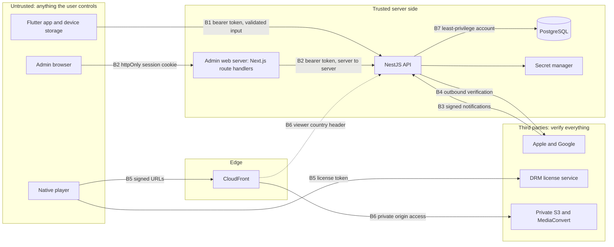

# Threat model

This document describes what StreamingApp protects, where the trust boundaries are, which attacks we
expect, and which concrete controls in this design answer them. It is written against the v1
[API contract](../architecture/api-contract.md) and the
[architecture overview](../architecture/overview.md).

**Security goal.** No streaming system can guarantee that a video is never copied. Our goal is that
nobody gets access they have not paid for, that extraction and redistribution are hard and
attributable, and that abuse is detectable and revocable.

## 1. Assets

| Asset | Why it matters | Where it lives |
|---|---|---|
| Premium video (encrypted renditions) | It is the product | Private S3 origin, CloudFront cache; DRM-encrypted in production |
| Master video files | Unencrypted, full quality: the most valuable thing to steal | Private S3 bucket; never delivered to viewers |
| Subscription and entitlement state | Decides who may watch | PostgreSQL (`subscriptions`, `entitlements`, `billing_transactions`) |
| Account credentials | Account takeover leads to free viewing and personal-data exposure | Password hashes and refresh-token hashes in PostgreSQL; tokens in platform secure storage on devices |
| Personal data | Legal duties under the DPDP Act and Rules; user trust | PostgreSQL (email, devices, playback history, audit logs), logs, analytics |
| Server secrets and keys | Anyone holding them can mint access | Cloud secret manager only (see [§8](#8-secret-handling-and-rotation)) |
| Admin capabilities | Publish, unpublish, revoke, read user data | `/v1/admin/*`, admin dashboard |
| Audit trail | Needed for investigations and accountability | `audit_logs`, `provider_events`, `drm_license_audit` |
| Service availability and cost | Abuse can run up CDN and DRM bills or deny service | API, CDN, DRM vendor |

## 2. Threat actors

- **Non-paying user** who wants premium content for free (client tampering, URL sharing, forged
  purchases).
- **Paying subscriber** who shares an account widely or re-distributes content.
- **Fraudster** abusing purchases, refunds or stolen payment methods.
- **External attacker** doing credential stuffing, token theft, API abuse or webhook forgery.
- **Device-level attacker** with a rooted, jailbroken or instrumented device.
- **Compromised admin** account or malicious insider.
- **Third-party risk:** SDKs in the apps, cloud and vendor misconfiguration.

## 3. Trust boundaries

| # | Boundary | Rule |
|---|---|---|
| B1 | Mobile app → API | Everything from the app is untrusted input. Bearer access tokens, strict validation (unknown fields → `400 VALIDATION_FAILED`), rate limits. The app never sends entitlement, price, role or country. |
| B2 | Admin browser → admin web server → API | API tokens live only in httpOnly, Secure, SameSite cookies set by Next.js route handlers; the browser never sees them. The API enforces `role: "admin"` on every `/v1/admin/*` call. |
| B3 | Billing providers → webhooks | Authenticity is verified before anything else (Apple signed JWS payloads, Google Pub/Sub push authentication, HMAC for the fake provider). |
| B4 | API → billing providers | Purchase proofs from the app are verified with the provider over TLS using server-held credentials. |
| B5 | Player → CDN and DRM | Only short-lived signed manifest/segment access and short-lived license tokens issued by the API for one playback session. |
| B6 | CDN ↔ origin and API | The S3 origin is reachable only through CloudFront. The viewer-country header is trusted only when `TRUSTED_COUNTRY_HEADER` is set **and** the API is reachable only through the CDN, which overwrites that header. |
| B7 | API → database | Private network, TLS, least-privilege runtime account separate from the migration account. |
| B8 | Development → production | Fake media and billing providers and `/v1/dev/*` routes cannot run with `NODE_ENV=production`; the API refuses to start. |

## 4. Attacks and defenses

| Attack | Defense in this design | Enforced in |
|---|---|---|
| Change a client flag (for example `isPremium = true`) | The server computes `SubscriptionView.hasAccess`; playback check 4 requires an active entitlement for premium content; no endpoint accepts a client-asserted status. | API playback and subscriptions modules |
| Call playback for premium content without paying | Ordered server-side checks on every new session; `403 ENTITLEMENT_REQUIRED`. | API playback module |
| Extract a permanent video URL | No permanent public URLs. Manifest URLs carry an expiry and a signature bound to the playback session; the S3 origin is private behind CloudFront; master files are never delivered. | Media provider, CDN |
| Replay a stolen or expired playback credential | Short TTL (`PLAYBACK_AUTH_TTL_SECONDS`, default 300); signature covers session id and expiry; tampered or expired URLs get `401 INVALID_SIGNATURE`; sessions can be revoked; DRM license tokens are short-lived. | Media provider, playback module |
| Keep watching after the subscription lapses | Heartbeats re-check account, content publication and region, entitlement and device; on failure the session is revoked and the client stops; a heartbeat on an ended session gets `403 PLAYBACK_SESSION_ENDED`. | Playback module, mobile player |
| Forge a purchase | `POST /v1/purchases/verify` accepts only the store's proof and verifies it with the provider; real providers fail closed (`503 PROVIDER_NOT_CONFIGURED`) until configured; a store subscription already linked to another account gets `409 PURCHASE_BELONGS_TO_OTHER_ACCOUNT`. | Billing module |
| Forge a webhook | Signature verified first; bad signature → `401 INVALID_SIGNATURE` with no state change. | Webhooks module |
| Replay or reorder a webhook | Events stored once by `(provider, eventId)`; repeats return `200 { "duplicate": true }` without re-applying; changes applied in one database transaction; event time compared before applying. | Webhooks module, database constraints |
| Share one account widely | `MAX_DEVICES` (default 3) registered devices, `MAX_CONCURRENT_STREAMS` (default 2) active sessions, stale-session window, device revocation by user or admin. | Devices and playback modules |
| Use someone else's device id | The device must belong to the caller and not be revoked (`DEVICE_NOT_REGISTERED`, `DEVICE_REVOKED`). | Devices and playback modules |
| Steal a refresh token | Refresh tokens rotate on every use and are stored hashed; presenting a rotated token revokes the whole session family (`401 INVALID_REFRESH_TOKEN`); access tokens live 15 minutes. | Auth module |
| Credential stuffing or brute force | Rate limiting (`429 RATE_LIMITED`), minimum password length of 10, a generic `INVALID_CREDENTIALS` error. | Auth module |
| Steal admin tokens through XSS | Tokens only in httpOnly cookies on the admin domain; the admin web server talks to the API server-to-server; `CORS_ORIGINS` limited to the admin origin. | Admin web, API |
| Escalate a viewer to admin | Role is server-side only (never accepted on register or profile updates); `/v1/admin/*` returns `403 FORBIDDEN` to non-admins; every admin write is audited. | API admin module, audit module |
| Spoof the viewer's country | Country comes only from the CDN-set header or `DEFAULT_COUNTRY_CODE`; the API origin accepts traffic only via the CDN. | API, CDN configuration |
| Download raw source files | Private S3; short-lived, single-purpose upload URLs; no download path for masters in the admin dashboard. | Media provider, admin |
| Hammer the playback or license API | Rate limits, concurrent-stream limits, monitoring of denials by error code. | API, monitoring |
| Steal a server secret from the app binary | The app contains no secrets (only the API base URL); all signing, store and DRM credentials are server-side in the secret manager. | Mobile build, secret manager |
| Read tokens from a device | Tokens and `installationId` live in platform secure storage (Android Keystore-backed storage, iOS Keychain); tokens and signed URLs are never logged. | Mobile app |
| Record the screen | DRM output protection where the OS supports it; `FLAG_SECURE` on Android playback screens; iOS screen-capture state is observed and protected playback is not captured by the OS. Residual risk remains (see [§6](#6-residual-risks)). | Mobile app, DRM |
| Fake providers left on in production | API refuses to start with fake modes when `NODE_ENV=production`; `/v1/dev/*` and `/v1/webhooks/fake` are not mounted. | API configuration |
| Deleted or suspended account keeps watching | Check 1 (account active) on every new session and heartbeat; `DELETE /v1/me` revokes login sessions, devices and playback sessions. | Users and playback modules |

## 5. Acceptance criteria

> **A changed client flag, a replayed or expired playback credential, or a forged purchase never
> yields a new playback authorization.**

Each check below should exist as an automated end-to-end test against the API (fake providers) and be
re-run against staging with the real providers before launch.

| # | Scenario | Expected result |
|---|---|---|
| 1 | Premium content, user with no subscription (whatever the app believes) | `403 ENTITLEMENT_REQUIRED`; no playback session created |
| 2 | `POST /v1/purchases/verify` with an extra field such as `"status": "active"` | `400 VALIDATION_FAILED`; subscription unchanged |
| 3 | Fake verify with an unknown `productId` | `400 INVALID_PURCHASE`; no access |
| 4 | Verify with `provider: "apple"` or `"google"` while unconfigured | `503 PROVIDER_NOT_CONFIGURED`; no access |
| 5 | Same store purchase submitted from a second account | `409 PURCHASE_BELONGS_TO_OTHER_ACCOUNT` |
| 6 | Webhook with a bad `X-Fake-Signature` | `401 INVALID_SIGNATURE`; no state change |
| 7 | Same webhook `eventId` delivered twice | Second call `200 { "duplicate": true }`; applied once |
| 8 | `EXPIRED`, `REFUNDED` or `REVOKED` event | `hasAccess: false`; next heartbeat revokes the session; new sessions get `403 ENTITLEMENT_REQUIRED` |
| 9 | `CANCELLED` event before period end | `status: "cancelled"`, `hasAccess: true` until `accessUntil` |
| 10 | Manifest URL with an expired `exp` or altered `sig`/`sid` | `401 INVALID_SIGNATURE` |
| 11 | Heartbeat on an ended or revoked session | `403 PLAYBACK_SESSION_ENDED` |
| 12 | Device revoked during playback | Next heartbeat `403 DEVICE_REVOKED`; new sessions refused |
| 13 | `deviceId` of another user | `403 DEVICE_NOT_REGISTERED` |
| 14 | One more stream than `MAX_CONCURRENT_STREAMS` | `403 CONCURRENT_STREAM_LIMIT` |
| 15 | Registering more than `MAX_DEVICES` devices | `409 DEVICE_LIMIT_REACHED` |
| 16 | Reusing a rotated refresh token | `401 INVALID_REFRESH_TOKEN`; every session in the family revoked |
| 17 | Viewer calling `/v1/admin/*` | `403 FORBIDDEN` |
| 18 | Content not available in the viewer's country | Hidden from the catalog, `404 NOT_FOUND` on detail, `403 REGION_NOT_ALLOWED` on playback |
| 19 | Suspended or deleted account | `403 ACCOUNT_INACTIVE` (or `401` once tokens are revoked) |
| 20 | `NODE_ENV=production` with `MEDIA_PROVIDER=fake` or `BILLING_MODE=fake` | API refuses to start |

## 6. Residual risks

These remain after every control above and are accepted, monitored or scheduled:

- **Screen and camera recording.** DRM and OS restrictions block many capture paths on many devices,
  but a camera pointed at a screen, or a compromised device, can still record. Watermarking (planned)
  helps attribute leaks; it does not prevent them.
- **Compromised, rooted or jailbroken devices.** Some Android devices only offer software-level
  Widevine (L3), and instrumented devices can bypass client controls. Mitigations: DRM license policy
  (for example limiting HD to hardware-backed security levels), device-integrity signals (not yet
  implemented) used as risk indicators, and server-side limits.
- **Account sharing within the limits.** Up to `MAX_DEVICES` devices and `MAX_CONCURRENT_STREAMS`
  streams can still be shared with friends. Anomaly detection (IP and location changes, unusual
  playback patterns) is future work.
- **Already-issued DRM licenses.** Revoking a playback session stops new credentials, but a license
  already issued is governed by the DRM vendor's policy. Keep licenses short and non-persistent.
- **Revocation latency.** Revocation takes effect at the next heartbeat (default every 30 seconds),
  bounded by the remaining lifetime of the issued credentials.
- **Insider misuse.** Admins can read user data and change publication state. Mitigated by audit
  logs and least privilege; admin MFA is still to come.
- **Third-party SDKs.** Analytics and crash SDKs can leak personal data or tokens; keep them minimal
  and review what they collect.

## 7. Not implemented yet

| Item | Current state | Needed before |
|---|---|---|
| Real DRM (Widevine, FairPlay) | Vendor not chosen; the fake media provider returns `drm: null` and redirects to an unprotected public test stream | Publishing premium content |
| Real AWS media pipeline | `MEDIA_PROVIDER=aws` is a fail-closed stub (`503`) | Staging |
| Real Apple and Google verification and notifications | Fail-closed stubs (`503 PROVIDER_NOT_CONFIGURED`) | Store sandbox testing |
| Scheduled reconciliation with store APIs | Not built | Launch |
| Watermarking (visible or forensic) | Not built | When content value justifies it |
| Device-integrity signals (Play Integrity API, App Attest / DeviceCheck) | Not built | Launch, as a risk signal only |
| Abuse and anomaly detection | Basic limits only | After beta |
| Admin multi-factor authentication | Not in the v1 contract | Production |
| Email verification and password reset | Not in the v1 contract | Launch |
| `drm_license_audit` population | Depends on the DRM vendor's callbacks or logs | With real DRM |
| Web checkout (Razorpay) | Out of scope for v1 | Later, if store rules allow |

## 8. Secret handling and rotation

Rules:

- Secrets live only in the cloud secret manager (production and staging) or in a local, git-ignored
  `services/api/.env` (development). Only `.env.example` with placeholders is committed.
- Nothing secret ships in the mobile app or the admin browser bundle. The app's only configuration is
  the API base URL.
- Separate secrets per environment; never reuse development values in staging or production.
- Least-privilege access: the API's runtime identity can read only the secrets it needs.
- Never log secrets, tokens, signed URLs or raw purchase proofs.
- Rotate at least yearly, immediately when someone with access leaves, and immediately on any
  suspected exposure. Record each rotation.

| Secret | Used by | Rotation notes |
|---|---|---|
| `JWT_ACCESS_SECRET` | API | Rotating invalidates access tokens within `ACCESS_TOKEN_TTL_SECONDS`; clients refresh. Supporting two active keys during rotation avoids forced re-login. |
| Refresh tokens | API | Stored only as hashes; revoked by logout, reuse detection, account deletion or admin action. |
| `SESSION_COOKIE_SECRET` | Admin web | Rotating signs all admins out. |
| Database credentials | API, migrations | Separate runtime and migration accounts; rotate through the secret manager. |
| CloudFront signing private key | API (media provider) | CloudFront key groups allow a new public key to be added before the old one is removed. |
| DRM vendor credentials and key material | API (media provider) | Per the vendor's rotation process; content keys managed by the vendor. |
| App Store Server API key, issuer and key ids | API (billing) | Create a new key in App Store Connect, deploy, then revoke the old one. |
| Google Play service account key and Pub/Sub push audience | API (billing, webhooks) | Prefer short-lived credentials where possible; otherwise rotate the key file. |
| `FAKE_MEDIA_SIGNING_SECRET`, `FAKE_WEBHOOK_SECRET` | API, development only | Never present in production. |
| `SEED_ADMIN_EMAIL` / `SEED_ADMIN_PASSWORD` | Seed script only | Development and staging only; change the password after first login. |
| Razorpay key secret and webhook secret | API (later) | Added with web checkout. |

## 9. Incident response outline

1. **Detect.** Alerts on spikes in denials by error code (`ENTITLEMENT_REQUIRED`,
   `INVALID_SIGNATURE`, `CONCURRENT_STREAM_LIMIT`), webhook signature failures, unusual admin
   activity in `audit_logs`, leaked content reported or found online, or a provider security notice.
2. **Triage.** Classify severity (data exposure, content leak, billing integrity, availability) and
   start an incident log with timestamps.
3. **Contain.**
   - Revoke a user's login sessions: `POST /v1/admin/users/:id/sessions/revoke`.
   - Revoke devices or playback sessions: `POST /v1/admin/devices/:id/revoke`,
     `POST /v1/admin/playback-sessions/:id/revoke`.
   - Unpublish affected content: `POST /v1/admin/content/:id/unpublish`.
   - Rotate any exposed secret (see [§8](#8-secret-handling-and-rotation)).
   - Disable a misbehaving integration so it fails closed.
4. **Eradicate.** Fix the root cause, patch, and add a regression test to the acceptance suite.
5. **Recover.** Re-enable features, reconcile subscriptions with the stores, and verify backups if
   data was touched.
6. **Notify.** For personal-data breaches, follow the DPDP Act and Rules: intimate the Data
   Protection Board and affected users within the timelines in the Rules (a detailed report within
   72 hours at the time of writing). Some cyber incidents must also be reported to CERT-In, currently
   within 6 hours. Confirm current obligations with counsel. Notify the stores, AWS or the DRM vendor
   when their systems are involved.
7. **Review.** Write a short post-incident review: timeline, impact, root cause, follow-up actions,
   and updates to this threat model.

Keep an up-to-date contact list for Apple, Google, AWS support, the DRM vendor and legal counsel.
